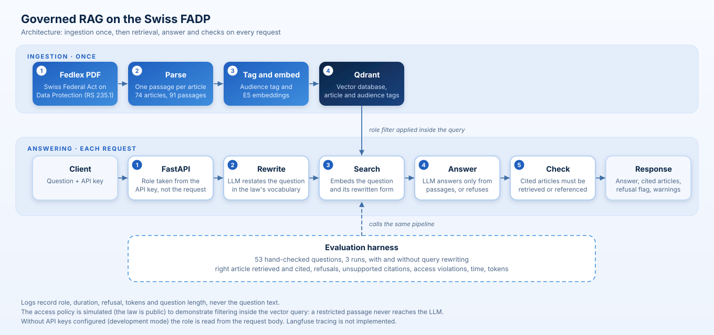
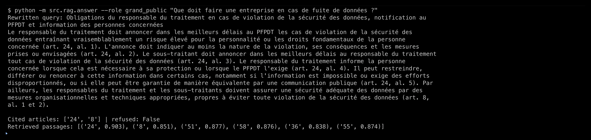
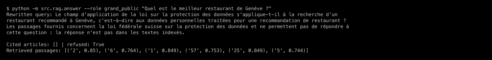
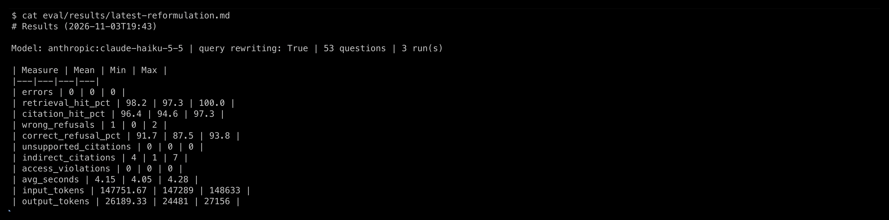
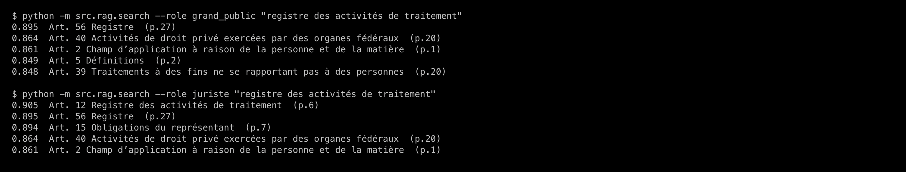
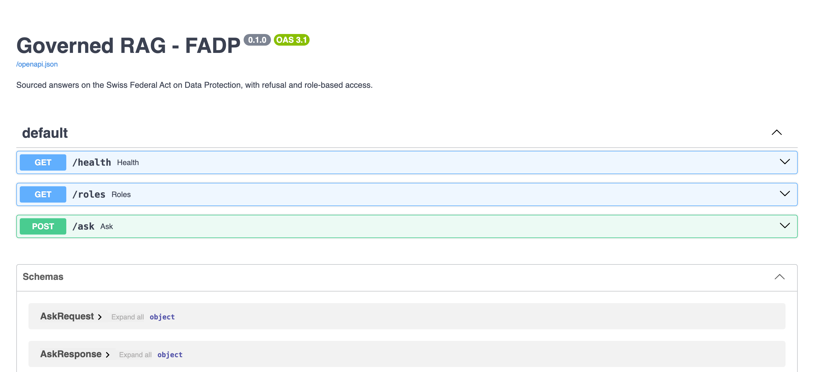
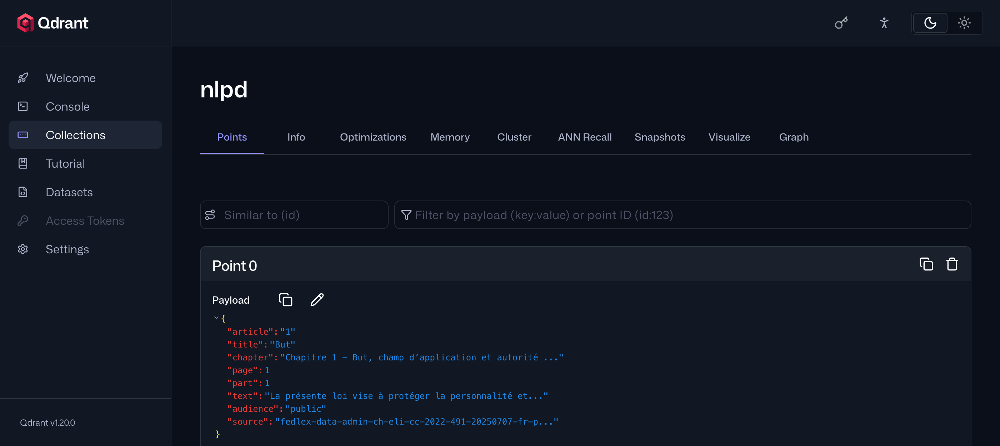

# Governed RAG on the Swiss Data Protection Act (FADP / nLPD) — work in progress

A retrieval-augmented assistant that answers questions on the Swiss Federal Act on Data Protection (FADP, French: LPD, RS 235.1)
and is built around **governance rather than demo effect**:

- every answer **cites the article** it relies on, and citations are checked against the retrieved passages;
- the assistant **refuses** when the text does not answer;
- access is **filtered by role inside the vector-database query**, so a restricted passage never reaches the LLM;
- quality is **measured** on a hand-checked test set, over several runs, with a before/after comparison of each improvement.

**Status (3 November 2026):** ingestion, retrieval, query rewriting, role filtering and the evaluation harness work.
The FastAPI service (`/ask`, `/health`, `/roles`, role taken from an API key) is implemented. Its logic is covered by tests that replace the model with a stub, and a real end-to-end call (question, rewriting, retrieval, answer with cited articles) was checked by hand on 3 November 2026.
Langfuse tracing is **not implemented** (requests are logged locally without the question text).

Development was assisted by an AI coding assistant (Claude Code). Design decisions, the review of the test questions and the
reading of the results are the author's; each question in `eval/questions.yaml` carries a note saying whether it was written
by the author or proposed by the assistant.

## How it works



```
Fedlex PDF -> split by article -> embeddings -> Qdrant (payload: article, audience)
                                                   ^
question -> LLM rewrites it in the vocabulary of the law -> search (original + rewritten, role filter)
                                                   |
                          top passages -> LLM answers ONLY from them, cites articles, or refuses
                                                   |
                          check: every cited article is retrieved or referenced by a retrieved passage
```

| Component | Choice |
|---|---|
| Language | Python 3.12 |
| Source text | Fedlex PDF of the LPD, version of 7 July 2025 (74 articles, 91 passages) |
| Embeddings | `intfloat/multilingual-e5-small` (local, open source) |
| Vector database | Qdrant (Docker) |
| LLM | `claude-haiku-5-5` through `pydantic-ai` (structured output: answer, cited articles, refusal flag) |
| API | FastAPI (role derived from an API key; request logs without the question text) |
| Tracing | not implemented (Langfuse is a possible addition) |

## Role-based access (demonstration policy)

The law is entirely public, so the access policy below is **simulated** to show the mechanism, as one would do with internal documents.
Each passage is tagged with an audience at ingestion time; the filter is part of the Qdrant query.

| Role | Sees |
|---|---|
| `grand_public` | `public` passages |
| `juriste` | `public` + `technique` passages (art. 10 to 18, 22 and 23: internal compliance obligations) |

## Evaluation

53 questions (`eval/questions.yaml`): 37 have an answer in the law, 16 should be refused (out of scope, other legal texts, or restricted to another role).
Every setting was run **3 times**: the model does not accept a temperature parameter, so its answers vary slightly from run to run.
Figures are mean (min to max).

| Measure | Retrieval only | With query rewriting |
|---|---|---|
| Right article retrieved | 89.2 % (deterministic) | **98.2 %** (97.3 to 100) |
| Right article cited, without refusal | 86.5 % | **96.4 %** (94.6 to 97.3) |
| Wrongful refusals (out of 37 answerable) | 4.3 (4 to 5) | **1** (0 to 2) |
| Correct refusals (out of 16) | **97.9 %** (93.8 to 100) | 91.7 % (87.5 to 93.8) |
| Citations without support in the passages | 0 | 0 |
| Citations via an internal cross-reference (legitimate) | 1.3 | 4 |
| Access violations (restricted passage retrieved) | 0 | 0 |
| Average time per question | 2.5 s | 4.15 s (+66 %) |
| Input tokens for the whole set | 122,409 | 147,752 (+21 %) |

**Reading.** Query rewriting makes the retrieval clearly better, because questions in everyday language
("how can I know what data a company holds on me?") do not use the vocabulary of the law ("right of access").
It is a trade-off, not a free win: the system also answers more readily to questions it should have refused, and it is slower.

### Known ambiguous test labels (kept as written, on purpose)

Two labels were judged debatable after the first results. They were **not changed**, because changing a label after seeing
the result amounts to improving the score by hand. They are reported here instead.

- **q039 — "Are there texts about artificial intelligence?"** (label: should refuse). The law never mentions AI (checked by text search).
  With rewriting, the system consistently answers "no passage mentions AI explicitly", then cites the provisions on automated processing
  (art. 5, 21, 25). This is arguably a better answer than a bare refusal; it counts as a failure here.
- **q036 — blurred sensitive data** (label: answerable, with a nuanced expected answer: the law covers identifiable persons but does not say
  whether blurring is enough). The system refuses in two runs out of three, which is also defensible.

Without these two questions the figures would be: right article cited 99.1 % (with rewriting) versus 88.9 % (without),
correct refusals 97.8 % versus 100 %. This is a sensitivity check, not the headline score.

## Screenshots

Real output of the commands shown on each image.

**A sourced answer** (articles cited, passages retrieved with their similarity score):



**A refusal** (question outside the law):



**Evaluation results** (53 questions, 3 runs, query rewriting on):



**Role filter**: the same query returns art. 12 (register of processing activities) only for the `juriste` role:



**API documentation** (FastAPI `/docs`) and **one indexed passage in Qdrant**, with the `article` and `audience` fields used by the role filter:





## Limits

- **Small test set** (53 questions, 3 runs): one question changes a score by about 2.7 points. No claim of statistical significance.
- **One law, one language.** The ordinances, cantonal laws and the GDPR are out of scope (and tested as refusals).
- **Role filtering works at passage level.** A restricted provision can still be hinted at by a public passage that refers to it:
  in one run, a `grand_public` question on the foreign representative (art. 14, restricted) was answered from art. 51 (public),
  which says that the authority may order that designation "in accordance with art. 14". The content of art. 14 did not leak,
  but the existence of the obligation did. Filtering by passage cannot prevent this.
- **The refusal message does not say that content is restricted** ("not in the indexed texts"), by design: saying it would reveal that it exists.
- **PDF parsing is imperfect.** Some footnotes may remain in the text, and chapter labels of the last articles are approximate.
- **Not legal advice.** The assistant restates the content of the law.
- **Cost in francs is not computed** (token counts are recorded; prices are not verified).

## Run it

Prerequisites: Docker, Python 3.12, `pdftotext` (poppler: `brew install poppler` on macOS), an Anthropic API key. Put the Fedlex PDF in `data/raw/` (see `data/README.md`).

```bash
docker compose up -d                       # starts Qdrant on localhost:6333
python3.12 -m venv .venv && source .venv/bin/activate
pip install -r requirements.txt            # installs the dependencies (several GB with PyTorch)
cp .env.example .env                       # then add your key to .env (never commit it)
python -m src.rag.ingest                   # reads the PDF, tags passages, builds the Qdrant collection
python -m src.rag.search --role juriste "registre des activités de traitement"   # retrieval only, no LLM call
python -m src.rag.answer --role grand_public "Que doit faire une entreprise en cas de fuite de données ?"
python -m eval.run_eval --runs 3           # full evaluation, 3 runs, results in eval/results/
python -m eval.run_eval --runs 3 --no-rewrite   # same without query rewriting (the "before")
uvicorn src.rag.api:app --reload           # starts the API; interactive docs on http://localhost:8000/docs
python -m tests.test_api                   # API tests (the model and Qdrant are replaced by a stub)
```

API example (development mode: the role is read from the request body):

```bash
curl -s localhost:8000/ask -H 'Content-Type: application/json' \
  -d '{"question": "Que doit faire une entreprise en cas de fuite de données ?", "role": "grand_public"}'
```

With `API_KEYS=key-a:juriste,key-b:grand_public` in `.env`, the role comes from the `X-API-Key` header and the `role` field is ignored,
so a caller cannot grant itself a wider role.

## Layout

```
docs/      architecture.svg
src/rag/   parse.py (PDF -> articles), ingest.py, search.py, roles.py, answer.py, api.py
tests/     test_api.py
eval/      questions.yaml, run_eval.py, results/ (raw JSON of the reported runs + summaries)
```

## Possible improvements

Ideas that are not commitments:

- Tracing of each call (cost, latency, errors), for example with Langfuse.
- Harder, independently written test questions and a larger evaluation run.

## Licence and data

The code is released under the MIT licence (see `LICENSE`). The legal text is not covered by it: it comes from Fedlex (fedlex.admin.ch); check the terms of reuse before redistributing it
(the PDF is not committed: `data/raw/` is ignored by git).
